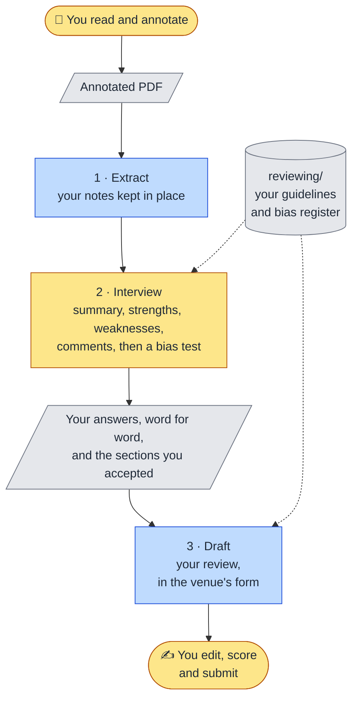

# Debrief: a paper review assistant

[](LICENSE)
[](docs/)

You read and annotate a paper. Debrief interviews you about your notes and drafts the review from your answers.

## Why

The aim is better paper reviews. Spend your time reading and making notes. Turning notes into a structured review is the slow part. A language model reads the paper and your notes together and helps with that part. The judgement stays yours.

- 🎙️ **Gets your judgement out quickly.** An interview about your notes that follows the review form, one section at a time, by voice or typing.
- ⚖️ **Checks for bias and weak reasoning.** Each point is tested against the paper and a [register](reviewing/BIASES.md) of known reviewing biases. It starts from the ARR reviewer guidelines and will grow.
- 📝 **Writes a structured review.** In the venue's template, each point traced to something you said. The summary is a plain description, drawn from the paper.

Read, annotate, talk it through, edit, submit.

**This is not a language model reviewing for you.** We do not condone using a language model to come up with the points of a review, or to decide whether a paper is accepted or rejected. Debrief helps you say what you already think, tests it, and writes it up. It should make you a better reviewer, not replace one.

## Quick start

> [!WARNING]
> **Submissions under review are confidential.** Debrief sends the whole paper and your notes to a language model. Use it only if your model setup is privacy-preserving and your venue allows this use. [Details](docs/review-interview.md#model-and-privacy).

You need [uv](https://docs.astral.sh/uv/), [Claude Code](https://claude.com/claude-code) (logged in) and a PDF annotated in Preview (Mac) or Okular (Linux).

```bash
git clone <this repository's URL>
cd debrief
uv sync
uv run interview --paper path/to/annotated-paper.pdf
```

A page opens: your points on the left, the interview in the middle, your paper on the right.

1. **Prepare the interview**, talk your notes through, then answer by typing or **Dictate**, and accept each section.
2. **Draft the review**.
3. **Copy Markdown** for each section into the review form. Edit it there, set the scores and submit.
4. **Save as submitted** keeps your final text as an example for later reviews. That is [the end](docs/review-interview.md#where-it-ends).

Drafts are saved in `outputs/reviews/`. Run the same command again to continue.

After a paper, `uv run stocktake --paper path/to/annotated-paper.pdf` shows where your time went and what you changed.

Before a real review:

- 📋 The form is ARR's; other venues are in the [interview docs](docs/review-interview.md).
- 🧭 The guidelines and biases in [reviewing/](reviewing/) are examples. Replace them with yours.

## How it works



Yellow is you, blue is Debrief, grey is a file. Each part has a guide: [1 · Extract](docs/annotation-format.md) · [2 · Interview](docs/review-interview.md#stages) · [3 · Draft](docs/review-interview.md#output-files) · [reviewing/](docs/review-interview.md#your-own-guidelines) · [all docs](docs/).
