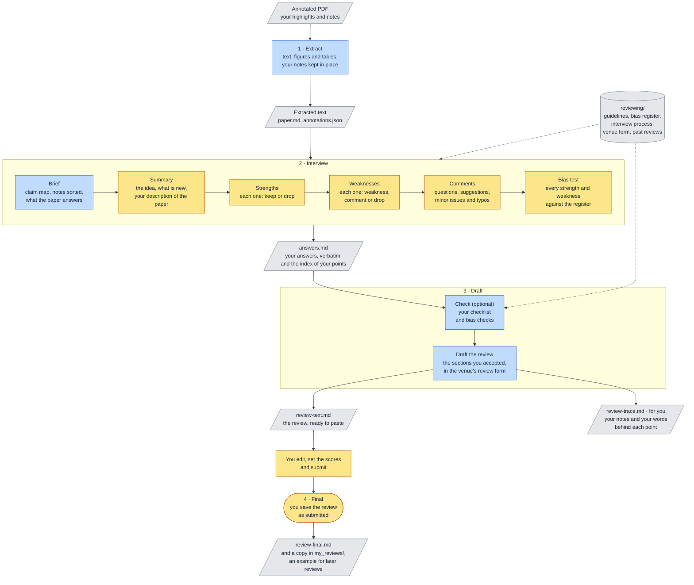

# The review interview

How an annotated PDF becomes a review. For the short version, see the quick start in the [README](../README.md).

ARR does not let a generative model write the first draft of a review. Here the first draft is what you say in the interview. The model words each section of the review from your answers, you accept or change it, and the app puts the review together from the sections you accepted. Whether this, and the model you use, fit your venue's rules is for you to check before a real review: see [Model and privacy](#model-and-privacy).

Debrief is not a language model reviewing for you. We do not condone using a language model to come up with the points of a review, or to decide whether a paper is accepted or rejected.

## Running it

```bash
uv run interview --paper reviews/<name>.pdf
```

| Option | Effect |
|---|---|
| `--paper` | Path to the annotated PDF |
| `--restart` | Start again. The saved interview and record are kept once, as `.bak` files |
| `--observations` | Let Claude offer up to three points of its own in the weaknesses section, as `O1`, `O2`, … You make each one a weakness or a comment, or drop it (off by default). Not for venues that require you to write the content of the review yourself, such as ARR |
| `--model`, `--effort` | Model and thinking effort for every turn of the interview after the brief (default: Opus 5.5, low) |
| `--deep-model`, `--deep-effort` | Model and thinking effort for the brief and the check (default: Fable 5.2, its own default effort) |
| `--port` | Port for the page (default 8765) |
| `--output-dir` | Output root (default `outputs`) |
| `--no-browser` | Do not open the page |

Submissions under review belong in `reviews/`, which is gitignored.

Run the same command again to continue an interview. One saved by the earlier, five-question version opens read-only: you can read it, with its draft and check, but not continue it. To interview again on that paper, use `--restart`.

The page has three columns:

- 🧭 **Left: the flow and the index.** The flow lists the steps: Brief, Summary, Strengths, Weaknesses, Comments, Bias test, Draft, Final. A finished step has a tick; click it to see it again, with its result and the exchange behind it. Under the flow is the index of your points, in the order of the review form: the summary, strengths (`S1`, …), weaknesses (`W1`, `W2`, …) most severe first, and comments (`C1`, …). The ☰ button at the top of the middle column hides the left column and brings it back.
- 💬 **Middle: the interview**, one step at a time. A step shows only where it stands now: the questions, or the section as it will appear in the review. Each question has your notes under it; what the paper says is folded under "From the paper". Earlier messages are folded under "The exchange so far". Answer by typing or with the dictation button, which writes into the text box you last clicked in.
- 📄 **Right: the PDF**, with your highlights as you made them and an ID badge on every note. References in a message (`A26`, `L267`, `Table 2`, `Section 3.3.2`) are links that scroll the paper to that spot.

Click an entry in the index, or its ID anywhere in a message, to open it; hovering over an ID shows its claim. An open entry shows its text as it will appear in the review, and you edit that text directly. Once you have, it is your wording: a later revision by the model does not replace it unless you ask for a change to that entry. Under the text are the notes it rests on, each with the words of the paper it is attached to. The parts the text was first built from (its label in the index, its location, its fix) are folded under "Parts". You can also move the entry to another kind (a weakness to a comment, say), drop or restore it, and move it up or down in the order of severity (the arrows on an index row do the same). None of that needs the model. At any point after the brief you can instead say what to change and let the model revise it.

Colour tells you whose a thing is. Teal marks what is yours: your answers, the step you are on, links and the main button. Gold marks a point Claude raised itself, until you adopt or drop it. Brick marks what is still open, and errors. The page of the paper and your highlights keep their own colours. The button at the top right switches between light and dark; the page starts from your system setting and remembers your choice.

A weakness is meant to have a location (where it shows) and a fix (what would resolve it), and a strength a location. A point without one is marked "no location yet" or "no fix yet". Open it and the places its notes sit in are offered as locations, to take with one click; where a point has no one place to cite, tick "No single location" under "Parts". You can also accept the section as it is: the button then reads "Accept … anyway". A point you worded yourself is not marked, since what it holds is yours to judge.

## Stages



Yellow is you, blue is Debrief, grey is a file. Rounded boxes start and end the flow, square boxes are steps, slanted boxes are files, and the cylinder is the set of documents you keep in [reviewing/](../reviewing/). Dotted arrows mean "is read by".

1. **Extraction** turns the PDF into text with the annotations in place (see [annotation-format.md](annotation-format.md)), plus the positions the page needs for its links.
2. **Interview.** It follows the review form, by the process in [reviewing/INTERVIEW.md](../reviewing/INTERVIEW.md): a brief, one section for each part of the review, then the bias test. The server writes the record, so each answer is stored exactly as sent.
   - **Brief.** The model reads the paper against your notes and reports: the paper's claims, how it sorted your notes, what the paper already answers, and the parts without notes. You correct it or go on.
   - **Summary.** You give the idea in one sentence, the closest prior work and what is new, and your description of the paper. The outline is the summary paragraph: five or six plain sentences, built only from what you described.
   - **Strengths.** Each positive remark in your notes is a candidate, to keep or drop. You add anything else that argues for acceptance.
   - **Weaknesses.** Each concern in your notes is a candidate, related notes merged, at most five. You make each one a weakness or a comment, or drop it. One more question covers the parts of the paper without notes.
   - **Comments.** Everything left in your notes: questions, suggestions, minor issues and typos. You confirm the list, move or drop items, and add what is missing. They go into the review as one list, in the order you set.
   - **Bias test.** It comes once, after the four sections, and covers every strength and weakness as it now reads. Where a signal from the [bias register](../reviewing/BIASES.md) is present, you get one question on that point: the condition under which it would not stand, and whether that condition holds. "Why is this asked?" shows the register entry behind it, what set it off and where the entry comes from, with a link where the source is a page. The questions stay on screen while you answer, each marked once your answer has settled it. Your answer decides whether the point stays, is reworded, moves to comments or is dropped. If you have two or more weaknesses and have not put them in order of severity, you are asked to.
3. **Draft.** The Draft step has two buttons.
   - **Check against your guidelines** (optional) runs the checklist and bias checks from your guidelines over the review as it stands and lists what is not met, one finding for each point. Where your notes and answers hold what the fix needs, the finding comes with a suggested rewording of the point, built from them and tied to the place in the paper your notes sit in. It adds no reason of its own. **Use this** takes the suggestion as the point's text, **Edit** opens the point, and **Set aside** dismisses the finding. Nothing changes until you choose.
   - **Draft the review** puts the review together in the venue's form, from the summary you accepted and the index, weaknesses most severe first. No model writes at this step. While an entry has a gap, the app says so and drafts only if you choose "Draft anyway". A point that began as one of Claude's observations is marked `[Claude]`. The review is followed by a part for you only: the notes and your words behind each point, then the points that came from Claude, the dropped points and any drafted with a gap.
4. **Final.** The step shows the draft, one block for each field of the form with a copy button, and under it a box that starts with the same text. When you have submitted, put the review as you submitted it in that box and press **Save as submitted**. See [Where it ends](#where-it-ends).

Each section of the interview, and the bias test, runs the same way:

- ❓ **Ask.** The questions, with the candidate points, each with buttons to keep, move or drop it. You can skip a section.
- 📝 **Outline.** The model writes the section as it will appear in the review, from your answer.
- ✏️ **Revise.** You edit it by hand, or say what to change. The model then revises and lists what it changed, with your words behind each change.
- ✅ **Accept.** The section is settled. Its entries stay open to changes in the index.

Scores, confidence and the recommendation are yours. You set them in the review form; Debrief never asks for them and suggests none. The Final step shows the register's reminders about scores, as fixed text, for when you set them.

## Where it ends

The review is finished when you have pasted each section into the review form, edited it there, set the scores and submitted.

Debrief has one step after that. **Save as submitted** stores your final text in `outputs/reviews/` and copies it to `reviewing/my_reviews/`, where it serves as an example of your voice in later reviews. The example is the text you submitted, never the draft.

There is no loop to work through. If the draft is not right:

- ✏️ **Open an entry** from the index and change it, by hand or by saying what to change.
- 🔁 **The draft follows.** Once drafted, the review is put together again after every change to the summary or the index. It does not see edits you made in the review form.
- ✅ **Check** lists what the review misses against your guidelines, with a suggested rewording where your notes support one. It changes nothing until you take a suggestion.
- ↩️ **A new interview** is the way to start over: run again with `--restart`.

The second interview after the author response, described in [reviewing/INTERVIEW.md](../reviewing/INTERVIEW.md), is not in the app yet.

## Output files

All under `outputs/reviews/`:

| File | Content |
|---|---|
| `<name>.answers.md` | The record: every question and your answer, word for word, then the summary you accepted and the index |
| `<name>.review-check.md` | The check of the review against your guidelines, if you ran it |
| `<name>.review-text.md` | The review alone, one `##` section per form field, ready to paste |
| `<name>.review-trace.md` | For you only: the notes and your words behind each point, points from Claude, dropped points, points drafted with a gap |
| `<name>.review-draft.md` | The two files above in one |
| `<name>.review-final.md` | The review as you submitted it, saved at the Final step |
| `<name>.session.json` | Conversation state, so a reload continues the interview |
| `<name>.usage.jsonl` | What you did, one line for each action, for the [stock-take](#stock-take-after-a-paper) |

The app puts the draft together from the sections you accepted; no model writes it. The Final step also copies the submitted review to `reviewing/my_reviews/`, as `ACL_ARR_<year>_<Month>_<name>.md`.

## Stock-take after a paper

While you work, the app keeps a usage log. It has one line for every request, with what the request changed: each part of a point before and after, the summary, the order, the step. Requests the app refused are in it too. It has another line for each thing you did on the page that sends no request: opening a point, unfolding a part, following a link into the paper, starting dictation, hiding the left column.

```bash
uv run stocktake --paper reviews/<name>.pdf
```

This prints a summary: the time each step took and how much of it was waiting for the model, what you changed by voice and by hand, what was refused, and which parts of the page you used. It is the basis for deciding, after each paper, what to keep and what to cut.

The log quotes you and the paper, so it stays in `outputs/`. Nothing in it leaves your machine.

## Your own guidelines

The interview is driven by the documents in [reviewing/](../reviewing/):

| File | Role |
|---|---|
| `REVIEWING_GUIDELINES.md` | How you review and how your reviews read |
| `BIASES.md` | The bias register: for each bias, the signal, the question to ask when it may be active, and its source. Add a row to add a bias |
| `INTERVIEW.md` | The interview process: stages and rules for questions |
| `venues/ARR.md` | The venue's review form |
| `my_reviews/` | Past reviews, used as examples of your voice: the five most recently saved for the venue go into a prompt. The Final step adds each review you save as submitted (gitignored, optional) |

The note numbers (`A1`, `A2`, …) follow the position of each annotation. If you add, move or delete an annotation after an interview has started, the saved interview no longer matches the paper and the app stops with a message. Start again with `--restart`.

Edit these in place. They are read from this folder only.

## Model and privacy

The model is the installed `claude` command-line tool, using your Claude Code login. It is called without tools, connectors, plugins or your personal Claude Code settings, so only the prompts in this repo shape the review. The page itself answers only to your own browser on this machine.

Two settings are used. The steps that need analysis and happen once run on Fable 5.2: the brief, where the paper is read against your notes, and the check. Every other turn of the interview runs on Opus 5.5 at low effort; you wait on these about ten times, more if you ask for revisions. The draft needs no model: the app puts it together from the sections you accepted. The split rests on one measurement, made on a question turn of the earlier five-question interview: Fable at default effort took 97 s and Opus at low effort 36 s, and both produced the same number of points and register entries with every cited figure and line reference found in the paper. That is one sample, not repeated on the section flow, so treat it as a guide.

### Before you use it on a real submission

A submission under review is confidential. Debrief sends all of it to a language model, so using it is only acceptable where both of these hold.

- 🔒 **The tool is privacy-preserving.** The ACL policy describes such a tool as one that does not store what you send, and a non-privacy-preserving one as a tool that stores input data, typically on a third party's servers. A reviewer may not put a submission, any part of it, or the review itself into a non-privacy-preserving tool. Whether your model account qualifies depends on its data terms, not on Debrief. Check them.
- 📜 **The use is one your venue approves.** ARR requires that you read the paper fully and write the content and argument of the review yourself, and does not permit generative assistance for the first draft. Paraphrasing your own review is given as a reasonable use. Debrief is built so that every judgement comes from your notes and answers, but the model also reads the paper and prepares a brief, which is more than a language edit. If you are not sure your venue allows that, ask the chairs or do not use it.

The rules are in the [ARR reviewer guidelines](https://aclrollingreview.org/reviewerguidelines) and the [ACL Policy on Publication Ethics](https://www.aclweb.org/adminwiki/index.php/ACL_Policy_on_Publication_Ethics), as read in November 2026. Read them yourself: they change, and other venues differ.

What leaves your machine:

| What | Where it goes |
|---|---|
| The whole paper text, your highlights and notes | The model provider, through the `claude` command |
| Your answers, your points as they stand in the index, and the review text when you run the check | The same |
| The five most recent past reviews in `reviewing/my_reviews/`, including those saved at the Final step, as examples in later interviews | The same |
| Dictation audio, if you use the page's Dictate button | The browser's speech service (Chrome: Google, Safari: Apple). macOS dictation in a text box can run on the machine instead |

Saving the review as submitted sends nothing: it is written to files on your machine.

What stays on your machine after the review: the files in `outputs/`, the copy of the submitted review in `reviewing/my_reviews/`, and the saved model conversations, which hold the paper and your answers. Claude Code keeps those under `~/.claude/projects/`, in the folder whose name ends in `cache-debrief-interview`. Delete `outputs/` and the conversations once the review is submitted and saved. The copy in `my_reviews/` is there to be kept; delete it too if you do not want it used as an example.

## Other venues and plain prompt files

The browser interview uses the ARR form. For COLM and ICLR, `review` extracts the annotated submission and wraps it in a review prompt to paste into a model, in one step:

```bash
uv run review --paper reviews/<name>.pdf --venue iclr --full
```

`--venue` is `colm` (default), `iclr` or `arr`. `--full` keeps the reference list and the whole appendix.

The ARR interview and a drafting prompt are also available as plain prompt files, for pasting into another model. On this path a model writes the draft from your answers file:

```bash
uv run review --paper reviews/<name>.pdf --venue arr --interview --full   # -> outputs/reviews/<name>.interview.md
uv run review --paper reviews/<name>.pdf --venue arr --full               # -> outputs/reviews/<name>.review.md (needs the answers file)
```

Templates are in `prompts/templates/`. Venue guidance collected while writing them is in [review_guidelines/](review_guidelines/).
