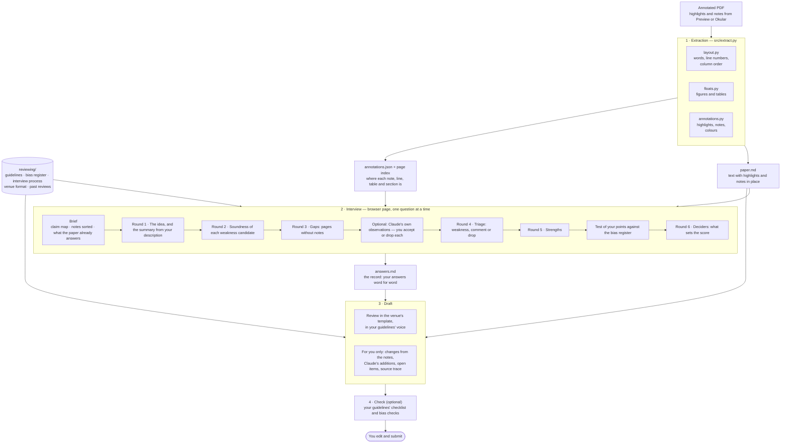

# The review interview

How an annotated PDF becomes a review. For the short version, see the quick start in the [README](../README.md).

ARR does not let a generative model write the first draft of a review. Here the first draft is what you say in the interview; the model writes the review from that record.

## Running it

```bash
uv run interview --paper reviews/<name>.pdf
```

| Option | Effect |
|---|---|
| `--paper` | Path to the annotated PDF |
| `--restart` | Start again. The saved interview and record are kept once, as `.bak` files |
| `--observations` | Let Claude offer up to three points of its own in question 3 (off by default) |
| `--model`, `--effort` | Model and thinking effort for the question turns (default: Opus 5.5, low) |
| `--deep-model`, `--deep-effort` | Model and thinking effort for the brief, the draft and the check (default: Fable 5.2, its own default effort) |
| `--port` | Port for the page (default 8765) |
| `--output-dir` | Output root (default `outputs`) |
| `--no-browser` | Do not open the page |

Submissions under review belong in `reviews/`, which is gitignored.

The page has the interview on the left and the PDF on the right, with your highlights as you made them and an ID badge on every note. References in a question (`A26`, `L267`, `Table 2`, `Section 3.3.2`) are links that scroll the paper to that spot. Answer by typing or with the dictation button.

## Stages



1. **Extraction** turns the PDF into text with the annotations in place (see [annotation-format.md](annotation-format.md)), plus the positions the page needs for its links.
2. **Interview.** The model prepares a brief, then asks one question at a time through the six rounds of [reviewing/INTERVIEW.md](../reviewing/INTERVIEW.md). Questions from the bias register are asked only where their signal is present; "Why this question?" shows which entry triggered one. Before the last round every weakness and strength is listed and tested against the register. The server writes the record, so each answer is stored exactly as sent.
3. **Draft.** A separate model call writes the review from the record, in the venue's template and the voice of your guidelines. It is followed by a part for you only: what changed from the notes, anything Claude added, open items, and a source trace quoting your words behind each item.
4. **Check (optional).** One click runs the checklist and bias checks from your guidelines over the draft and lists what is not met. Scores are not asked for: you set them in the review form.

## Output files

All under `outputs/reviews/`:

| File | Content |
|---|---|
| `<name>.answers.md` | The record: every question and your answer, word for word |
| `<name>.review-text.md` | The review alone, one `##` section per form field, ready to paste |
| `<name>.review-trace.md` | For you only: changes from the notes, Claude's additions, open items, source trace |
| `<name>.review-draft.md` | The drafting step's whole output (the two files above in one) |
| `<name>.review-check.md` | The check of the draft against your guidelines, if you ran it |
| `<name>.session.json` | Conversation state, so a reload continues the interview |

## Your own guidelines

The interview is driven by the documents in [reviewing/](../reviewing/):

| File | Role |
|---|---|
| `REVIEWING_GUIDELINES.md` | How you review and how your reviews read |
| `BIASES.md` | The bias register, with the question to ask when a bias may be active |
| `INTERVIEW.md` | The interview process: rounds and rules for questions |
| `venues/ARR.md` | The venue's review form |
| `my_reviews/` | Past reviews, used as examples of your voice (gitignored, optional) |

The note numbers (`A1`, `A2`, …) follow the position of each annotation. If you add, move or delete an annotation after an interview has started, the saved interview no longer matches the paper and the app stops with a message. Start again with `--restart`.

Edit these in place. They are read from this folder only.

## Model and privacy

The model is the installed `claude` command-line tool, using your Claude Code login. It is called without tools, connectors, plugins or your personal Claude Code settings, so only the prompts in this repo shape the review. The page itself answers only to your own browser on this machine.

Two settings are used. Steps that need analysis and happen once (the brief, where the paper is read against your notes; the draft; the check) run on Fable 5.2. The question turns, which you wait on five to eight times, run on Opus 5.5 at low effort. On one measured question turn, Fable at default effort took 97 s and Opus at low effort 36 s, and both produced the same number of points and register entries with every cited figure and line reference found in the paper. That is one sample, so treat it as a guide.

Browser dictation sends audio to the browser's speech service (Chrome: Google, Safari: Apple). macOS dictation in the text box can run on-device.

ARR forbids uploading a submission to a tool that is not privacy-preserving, so check the data settings of the model you use.

## Other venues and plain prompt files

The browser interview uses the ARR form. For COLM and ICLR, `review` extracts the annotated submission and wraps it in a review prompt to paste into a model, in one step:

```bash
uv run review --paper reviews/<name>.pdf --venue iclr --full
```

`--venue` is `colm` (default), `iclr` or `arr`. `--full` keeps the reference list and the whole appendix.

The two ARR steps are also available as plain prompt files, for pasting into another model:

```bash
uv run review --paper reviews/<name>.pdf --venue arr --interview --full   # -> outputs/reviews/<name>.interview.md
uv run review --paper reviews/<name>.pdf --venue arr --full               # -> outputs/reviews/<name>.review.md (needs the answers file)
```

Templates are in `prompts/templates/`. Venue guidance collected while writing them is in [review_guidelines/](review_guidelines/).
